# BearRok

**BearRok** brings internships, events, clubs, programs, and career paths to one student, then keeps a roadmap and the applications.

**Bold** is an agent or a part of BearRok. *Italic* is a limit. <u>Underline</u> is a rule you must not miss.


<u>There is no license file</u> in this repo, and there are no GitHub workflows.

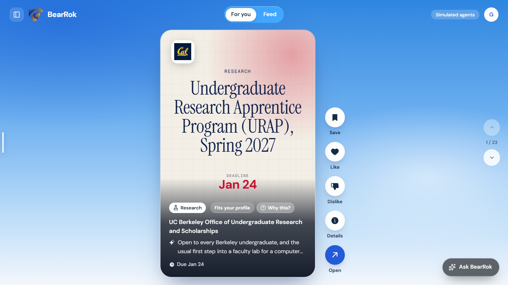

The For you reel for the demo student. The badge says Simulated agents. These cards were read from organizer pages on 2026-11-25. <u>These cards are not a live agent run</u>.

> **One minute.** Node 24 or newer. Two terminals, from a clone of this repo.
>
> ```
> git clone https://github.com/samueldotrung03/BearRok.git
> cd BearRok/backend
> npm ci
> npm run dev
> ```
>
> ```
> cd BearRok/dashboard
> npm ci
> npm run dev
> ```
>
> Open http://localhost:5173. With no Firebase web settings, sign-in is off and the app opens as the guest demo student. The backend must be running. The dashboard does not ship its own sample feed.

## Contents

1. [The problem](#the-problem)
2. [The answer](#the-answer)
3. [Why you can trust it](#why-you-can-trust-it)
4. [What one run does](#what-one-run-does)
5. [A look inside](#a-look-inside)
6. [Meet the agents](#meet-the-agents)
7. [Why now](#why-now)
8. [Try it](#try-it)
9. [How it works](#how-it-works)
10. [Configuration](#configuration)
11. [Tests](#tests)
12. [Repo layout](#repo-layout)
13. [Roadmap](#roadmap)
14. [Read next](#read-next)

## The problem

A student hears about internships, events, clubs, research, scholarships, and careers in different places. Deadlines live on organizer pages, and a closed posting is easy to miss. **BearRok** keeps one feed, one roadmap, and a list of applications for that student.

## The answer

The **Host** is code, not a model. **SimBrain** is the stand-in when no model is connected.

Gold nodes are the **Host**. Blue nodes are one model call.

1. Plan

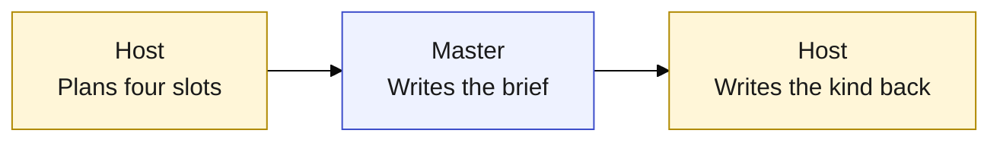

2. Search

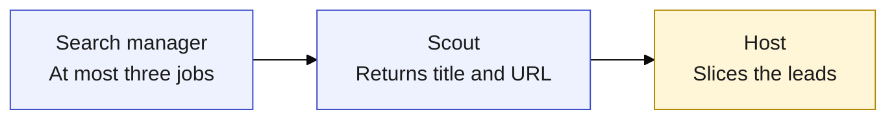

3. Read

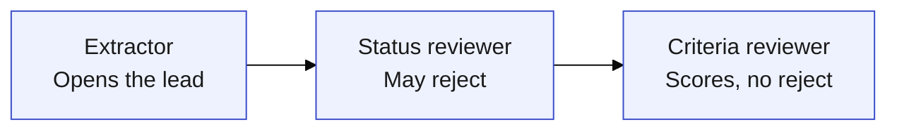

4. Keep

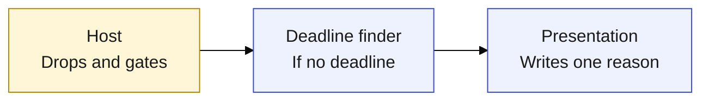

5. Order

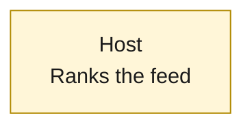

1. The **Host** plans four manager slots with `planLineup` and names them. The **Master** writes the brief, the lenses, and the focus. The **Host** writes kind, name, and category back over that answer.
2. Each **Search manager** returns *at most three jobs*. A **Scout** returns title-and-URL leads. The **Host** slices that list: *two leads on the CLI*, and *four on the API* and for **SimBrain**.
3. An **Extractor** opens the lead. The **Status reviewer** may reject the posting. The **Criteria reviewer** scores a match from 0 to 100 and does not reject it. A rejection that rests only on whether it is open, or on something not confirmed, is overruled in `reviewGuard.ts`.
4. The **Host** drops a posting that fails `hardCheck` (the **Status reviewer** said it is closed, the deadline has passed, or there is no real link) and one under the student's minimum. The default is a *match minimum 30*.
5. On a live run, `gateLiveCard` fetches the posting page. An unreachable link drops the card. A blocked fetch keeps the card and clears the deadline. A deadline quote stays only when every sentence of 12 or more characters is on the page. A skipped link check counts as blocked.
6. If the organizer pages stated no deadline, and the fetch was not blocked, the **Deadline finder** is the only extra-listing search. It runs *three deadline queries*: the title plus "deadline", the title plus "apply by", and the title plus the year. A date is stored only when `quoteOnPage` passes and the date is not in the past.
7. The **Presentation manager** writes *one reason sentence* per card. It does not order the feed. The **Host** orders with `rankFeed` in `backend/src/agents/scoring.ts`, from the student's history. Those estimates come from that history, not from a trained model. The dashboard orders the reel again in `dashboard/src/state/ranking.ts`. That browser ranker is a stand-in on the student's own saves, likes, and dislikes. It is not the X For You algorithm.
8. Stop runs inside `withSignal`. A `StoppedError` ends model calls and page fetches that are still going. Cards already kept stay in the feed.

Each live agent is one model call checked against a schema. **SimBrain** fills the same roles from an invented catalog. The demo feed is a different set of cards, loaded in advance, and opening it does not start a search.

## Why you can trust it

<pre>
Trust
├── <b>Host</b>
│   ├── plans kinds and names before the <b>Master</b> (`planLineup` in `lineup.ts`)
│   ├── writes kind, name, and category back (`system.ts`)
│   ├── slices leads after the model answers (`data.leads.slice`)
│   ├── CLI target <i>8</i>, and `FEED_MIN` does not change it (`engine()` in `server.ts`)
│   ├── API and simulated target <i>12</i>, scout cap <i>4</i>, <i>at most four fills</i> (`config.feed`, `DEFAULT_OPTIONS`)
│   ├── parses every live call (`grokJson` calls `schema.parse`)
│   ├── stops with `withSignal` and `StoppedError` (`stop.ts`)
│   ├── drops closed, expired, or unlinkable cards before the score (`hardCheck` in `match.ts`)
│   ├── keeps the criteria verdict, then applies the minimum, <i>default 30</i> (`meetsThreshold`)
│   ├── overrules a groundless rejection (`groundlessReject` in `reviewGuard.ts`)
│   ├── live gate (`gateLiveCard` in `evidence.ts`)
│   │   ├── unreachable link drops the card
│   │   ├── blocked fetch keeps the card and clears the deadline
│   │   └── a quote stays only if each sentence of 12 or more characters is on the page
│   └── stores another listing's deadline only after `quoteOnPage`, and not if the date has passed
├── <b>Search manager</b>
│   └── <i>at most three jobs</i> (`planJobs` keeps `data.jobs.slice(0, 3)`)
├── <b>Scout</b>
│   ├── <u>the CLI <b>Scout</b> is told not to open pages, but that call omits maxTurns, so grokCli.ts also says to open them. The <b>Host</b> still slices to <i>two leads</i></u>
│   ├── when `scoutMaxLeads` is set, that string also says to run the query once and return <i>at most two title-and-URL pairs</i>
│   ├── tools are `web_search`, plus `x_search` when `XAI_X_SEARCH=1`
│   └── the API prompt does not say to skip opening pages
├── <b>Criteria reviewer</b>
│   └── scores the match and does not reject
├── <b>Deadline finder</b>
│   └── its prompt says to open pages, and it also omits maxTurns, so those two lines agree
├── <b>Search</b>
│   ├── web off: `tools: []`, and the prompt says to rank only the student's own postings
│   └── web on: one lookup (`web_search` only, <i>maxTurns 2</i>), then a fill with no tools that says not to search
├── <b>Roadmap</b>
│   ├── one search, then a fill with no tools (`writeRoadmap`)
│   ├── a thin draft is filled again with no tools
│   └── `x_search` only when `XAI_X_SEARCH=1`
└── <b>Career</b>
    ├── one search (`careerSearch`, <i>maxTurns 2</i>), then writers with no tools
    └── `x_search` only when the harness provider is Grok, not from `XAI_X_SEARCH`
</pre>

`GROK_CLI_ALWAYS_APPROVE` stays unset. `1` would pass `--always-approve`, which also approves shell and file tools.

## What one run does

<pre>
One run
├── Starts
│   ├── manual request, profile change, schedule, or automode
│   ├── the fifth save, like, or dislike (`feedbackThreshold` <i>5</i>)
│   ├── a fill when the feed is under its target
│   ├── a first visit only when `runCount` is 0
│   └── the demo student is stored with `runCount` 1, so opening that feed does not search
├── CLI size
│   ├── about <i>8</i> cards
│   ├── <i>2 leads</i> per <b>Scout</b>
│   ├── `GROK_CLI_CONCURRENCY` <i>3</i>
│   └── `LIVE_MAX_JOBS` <i>12</i>
├── API and simulation size
│   ├── target `FEED_MIN` <i>12</i>
│   ├── scout cap <i>4</i>
│   └── up to `FEED_FILL_MAX_RUNS` <i>4</i>
├── Kept card
│   ├── stored as it is kept, origin `live` or `prepared`
│   ├── the presentation reason is stored beside it
│   ├── the <i>four strongest new cards</i>, by match, go to the <b>Application reader</b>
│   ├── when the shared opportunities table is open, saving memory copies postings into it
│   └── the search does not read that table
└── Reminders
    ├── default <i>7, 2, and 0 days</i> before a deadline
    ├── the app records them and <u>sends no email</u>
    └── with Google Calendar connected, the same offsets are popup minutes
</pre>

## A look inside

These are the running app, desktop width, with the backend up and no model connected. The guest is the demo student John, a computer science junior at UC Berkeley. Sample path counts on the roadmap are labeled on the page as a draft.

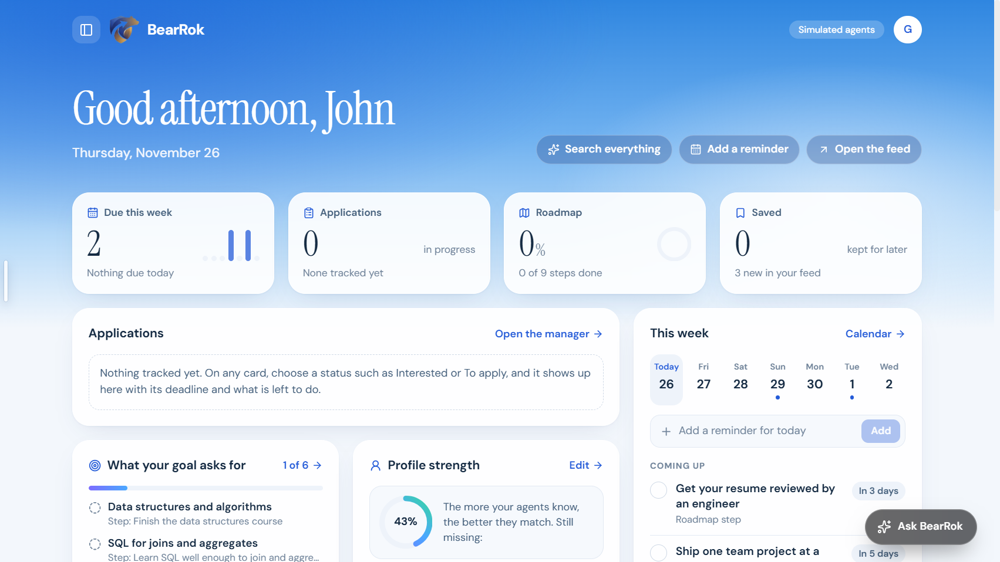

Today. The page greets John and shows the week, due dates, and an empty application count. The badge says Simulated agents.

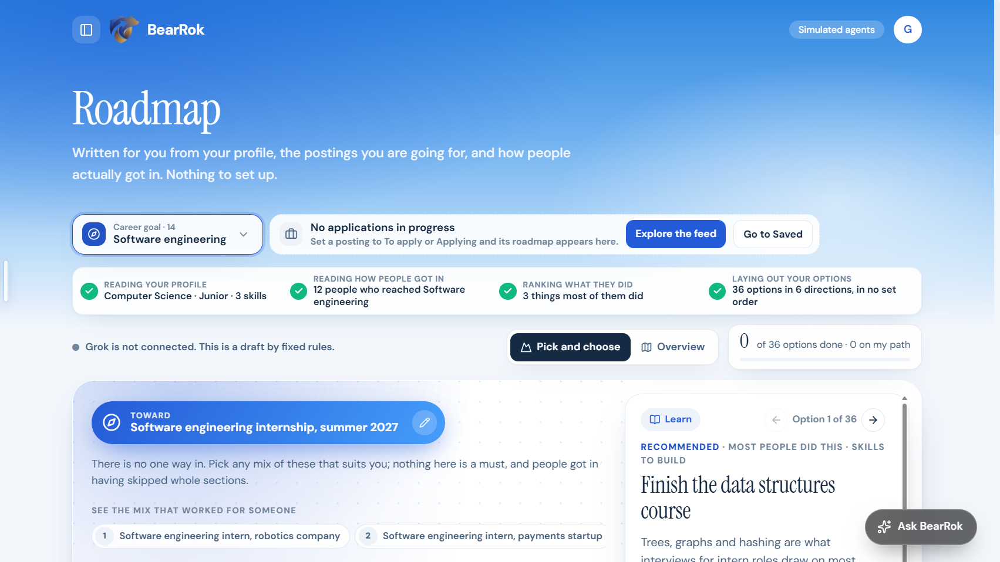

Roadmap for the career goal Software engineering. The page says Grok is not connected and that this is a draft by fixed rules. The "12 people who reached Software engineering" line is counted from sample path profiles in `dashboard/src/data/sample.ts`, not from a model.

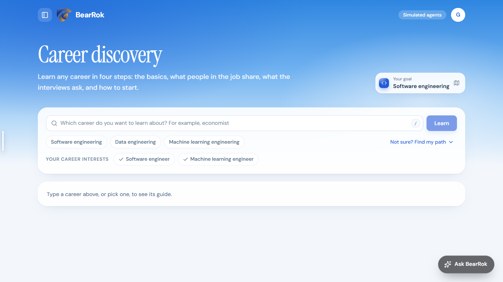

Career discovery with the goal filled in and no guide written yet. The empty panel says to type or pick a career.

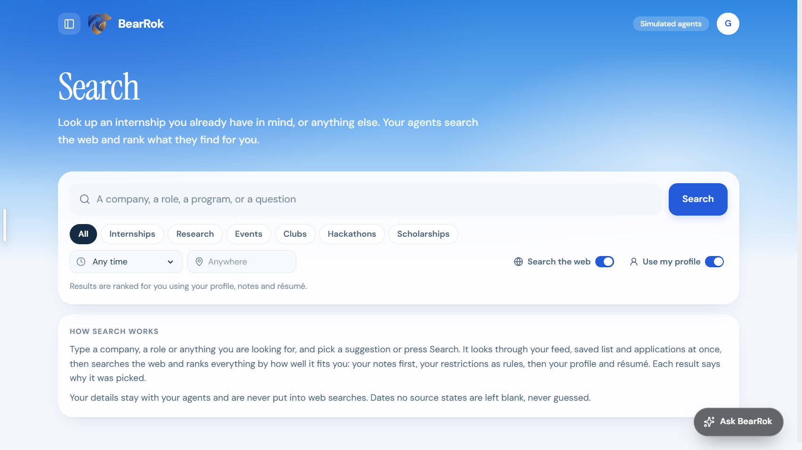

Search before any query. The web and profile toggles are on. Nothing was searched for this picture. If you search with no model, the page says only your own postings were searched.

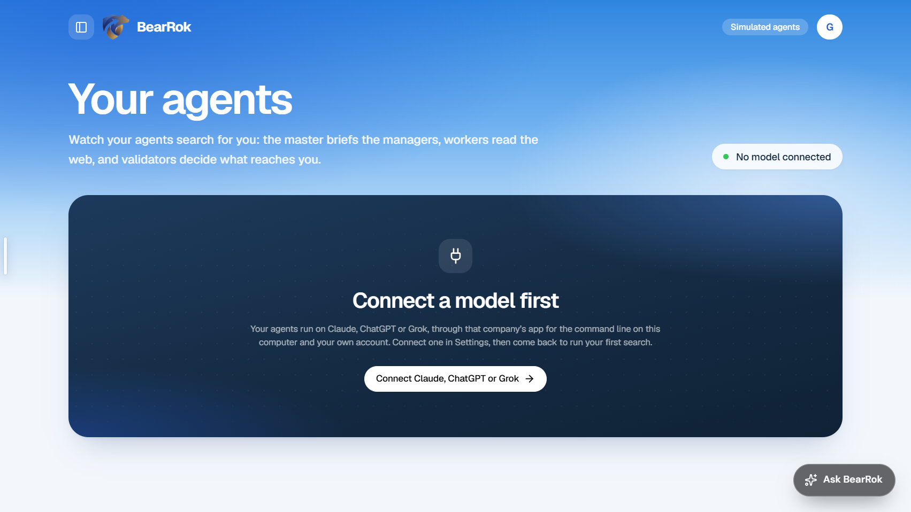

Agents with no model connected. The page says to connect a model first. It does not draw a simulated fleet. The badge still says Simulated agents.

Applications (`/applications`) and Saved (`/saved`) were empty for this guest: no applications yet, and nothing saved. Those two screens are not included.

## Meet the agents

Opportunity search roles that the **Host** actually calls:

| Role | May | May never |
| --- | --- | --- |
| **Master** | Write the brief, lenses, and focus. Read the profile, résumé text, and memory | Assign manager kinds or names. The **Host** overwrites those |
| **Search manager** | Turn one assignment into *at most three* search jobs | Cover another manager's kind. The **Host** set the kind |
| **Scout** | Return title-and-URL leads, sliced to the cap | Invent a URL the **Host** will trust without the later checks. On the CLI, the system string says not to open pages; the CLI wrapper still says to open them when `maxTurns` is omitted |
| **Extractor** | Open the lead and fill a record with quotes from that page | Search other listings for a deadline. That is the **Deadline finder**'s job |
| **Deadline finder** | Run the three named queries and return a date, a URL, and a quote | Store the date by itself. The **Host** checks the quote and drops past dates |
| **Status reviewer** | Keep or reject from the posting's own page | Set the match score |
| **Criteria reviewer** | Score the match | Reject the card. The **Host** applies the minimum |
| **Presentation manager** | Write one reason sentence per card | Order the feed or write the roadmap. The on-screen role string still says it orders the feed. `present()` does not |
| **Application reader** | Read prompts and required materials on the apply page, for up to *four* new cards | Decide whether the card stays in the feed |

Career discovery, when a student asks for a guide:

| Role | May | May never |
| --- | --- | --- |
| **Career master** | Name the career and set each part's angle (`career_plan`). On "Add more", decide whether the ask stays on the guide or belongs on the feed (`career_ask`) | Search. Those calls set no tools |
| **Career manager** | Nothing as a model. `managerBrief` writes the **Researcher**'s job as text | Call a model. `CAREER_TIERS.manager` is `none` |
| **Career search** | One search, *maxTurns 2*. `x_search` only when the harness provider is Grok | Look for internships or postings. The prompt forbids that |
| **Researcher**, **validator**, **presentation** | Write or check one part from the notes already gathered. No tools are set | Search. Voices on a harness that is not Grok are sample stories, and the code labels them that way |

**SimBrain** implements the same opportunity-search brain when no model is connected. Other model calls in `grokBrain.ts`: **calendar event**, **calendar sorter**, **illustrator**, **poster designer**, **poster art review**, **icon drawer**, and **application drafter**.

## Why now

The listings already exist on organizer pages, department sites, and event listings. What a student still does by hand is keep the ones that fit, notice the deadline, and remember where an application stands. **BearRok** is that list, a roadmap toward a career goal, and a tracker. Order comes from this student's history. An older draft of this README described the feed as the X For You algorithm. That was a plan. <u>This is not the X For You algorithm</u>. <u>No pass^k evaluation has been run</u>.

## Try it

### Sample app

Start the backend with no `XAI_API_KEY` and no harness connected in Settings. Start the dashboard. Sign-in stays off unless `FIREBASE_WEB_API_KEY` and `FIREBASE_PROJECT_ID` are set, and the app enters as the guest. Today greets John. The feed is his preloaded postings (`origin` `live`, found by a web check on 2026-11-25). The badge says Simulated agents because no model is connected.

The Agents page hides Run now until a model is connected. The backend still builds a **SimBrain** when nothing is connected. A run that does start, such as `POST /api/students/:id/runs`, searches the invented catalog in `backend/src/agents/catalog.ts` (those links are `example.org`) and stores cards with origin `prepared`. That catalog is not the feed in the screenshot.

`VITE_NO_SIGNIN` and `VITE_SAMPLE_FEED` are not read by the app. The only dashboard flag is `VITE_API_URL`.

### Backend

```
cd backend
npm ci
npm test
npm run typecheck
npm run dev
```

`npm run dev` listens on port 8787. Guest memory stays in a local file. Signed-in students can use Firestore when account storage is configured.

### Live model

Connect Claude, ChatGPT, or Grok in Settings, or set `XAI_API_KEY` for the xAI API. A feed run, a career guide, or a roadmap spends model time. <u>Leave GROK_CLI_ALWAYS_APPROVE unset</u>.

The model does not open this app. The dashboard is a page on your machine. <u>Grok cannot open 127.0.0.1</u>.

On the CLI, a run is the smaller one: *feed target 8* and at most *two leads on the CLI* per **Scout**. On the API, the *feed target 12*.

## How it works

The dashboard is a React app on Vite, port 5173. It calls the backend at `VITE_API_URL`, default `http://localhost:8787`. The feed on screen is the backend's cards only. If the backend is down, the pages say so and stay empty. `Feed.tsx` then reorders those cards with `rankFeedDetailed`.

Search from the search page is separate from a feed run. With a model and the web toggle on, `writeSearch` does one lookup (`web_search` only, *maxTurns 2*) and then fills the answer with no tools. The fill is told not to search. With a model and the web toggle off, the tool list is empty and the prompt says to rank only the student's own postings. `x_search` is not on this path. With no model, the local search marks `ai` false, and the page says: "Grok is not connected, so only your own postings were searched." It does not call the web route. That route, `POST /api/students/:id/search`, answers 503 if it is called with no model.

A career guide is one search (*maxTurns 2*), then a **Researcher**, a **validator**, and a **presentation** writer, each with no tools. `x_search` is included only when `provider()` is `grok`.

A roadmap is one search (*maxTurns 2*), then a fill with no tools. If the draft is thin, it is filled once more, still with no tools. `x_search` is included only when `config.xSearch` is on. With no model, the roadmap route answers 503 and the page draws the fixed-rule draft you see in the screenshot.

Opportunity workers (`tools()` in `grokBrain.ts`) get `web_search`, plus `x_search` when `XAI_X_SEARCH=1`. That includes the **Scout**, the **Extractor**, and the **Deadline finder**.

An older clubs-and-events worker in `workers.ts` is still in the tree, with its own *maxTurns 2* search. The feed run goes through `AgentSystem`, not that file.

Google sign-in, Calendar, and Sheets are optional. Their variables live in `googleOAuth.ts`, not in the table below.

## Configuration

Only variables read in `backend/src/config.ts`, plus the one dashboard flag. Defaults are what the code uses when the variable is unset.

| Variable | Default | What it does |
| --- | --- | --- |
| `PORT` | `8787` | Backend port |
| `XAI_API_KEY` | unset | Selects the xAI API when no harness is active |
| `XAI_BASE_URL` | `https://api.x.ai/v1` | API base |
| `XAI_MODEL` | `grok-4.7` | Fallback model name |
| `XAI_MODEL_HIGH` | `grok-4.7` | Read, and assigned to no level |
| `XAI_MODEL_NORMAL` | `grok-4.5` | Master, managers, validators, presentation |
| `XAI_MODEL_LOW` | `grok-4.3` | Workers |
| `CLAUDE_CLI_TIMEOUT_MS` | `240000` | Claude CLI call timeout |
| `CLAUDE_EFFORT` | unset | Passed through as `--effort` when set |
| `LIVE_MAX_JOBS` | `12` | Job cap on a CLI run |
| `FEED_MIN` | `12` | Feed target for the API and for simulation. The CLI target stays 8 |
| `FEED_FILL_MAX_RUNS` | `4` | How many times a short feed may search again |
| `CODEX_CLI_TIMEOUT_MS` | `240000` | ChatGPT CLI call timeout |
| `GROK_CLI_ALWAYS_APPROVE` | unset | Leave unset. `1` passes `--always-approve` |
| `GROK_CLI_TIMEOUT_MS` | `240000` | Grok CLI call timeout |
| `GROK_CLI_EFFORT` | `low` | Reasoning effort. An empty value uses the CLI default |
| `GROK_CLI_CONCURRENCY` | `3` | CLI processes at once |
| `XAI_X_SEARCH` | off | `1` adds `x_search` for opportunity workers and the roadmap search. Career search does not use this flag |
| `STUDENT_STORE` | local file | `account` stores signed-in students in Firestore |
| `FIREBASE_SERVICE_ACCOUNT` | unset | Service account JSON path |
| `FIREBASE_WEB_API_KEY` | unset | Both this and the project id turn sign-in on |
| `FIREBASE_PROJECT_ID` | unset | Firebase project |
| `FIREBASE_AUTH_DOMAIN` | unset | Firebase auth domain |
| `MAX_RESULTS_PER_TYPE` | `3` | Cap applied in `pipeline.ts` |
| `GROK_TIMEOUT_MS` | `120000` | API call timeout |
| `PREPARED_STEP_MS` | `1200` | Pause between simulated stages |
| `LOCAL_DATA_FILE` | `backend/.data/store.json` | Guest and local student file |
| `OPPORTUNITIES_DB` | on | `off` disables the shared table |
| `DATABASE_URL` | unset | Hosted Postgres for that table. Without it, a folder on this machine is used |
| `OPPORTUNITIES_DB_DIR` | `backend/.data/opportunities-db` | Local table directory |
| `USAGE_TRACKING` | on | `off` stops it. Rows are keyed by a one-way code, not a name or email |
| `METRICS_TOKEN` | unset | Password for `GET /api/metrics`. With none, that route answers nobody |
| `CAREER_GUIDES_FILE` | `backend/.data/career-guides.json` | Saved guides |
| `VITE_API_URL` | `http://localhost:8787` | Dashboard only, in `dashboard/src/auth/firebase.ts` |

Connecting a model in the running app is Settings, or `XAI_API_KEY` at startup. Which harness is active is decided in `harness.ts`, not by a variable in this table.

## Tests

No pass counts are listed here. Run them yourself.

```
cd backend
npm test
npm run typecheck
```

`npm test` is `node --test "test/*.test.ts"`. The files cover the **Host** loop, the evidence gate, lineup, match, search, roadmap, careers, the harness, the Grok CLI argument builder, the demo student, and the shared table.

```
cd dashboard
npm test
npm run typecheck
```

`npm test` is `vitest run`. It covers dashboard state, the browser ranker, and the page helpers.

`npm run grok:check`, `npm run probe:live`, and `npm run roadmap:check` in `backend/` call a live model and spend model time. `npm run opportunities:backfill` and `npm run usage:report` are maintenance scripts, not the test suite.

## Repo layout

```
backend/           agent host, HTTP API, tests
dashboard/         React app (Vite, port 5173)
website/           pitch site, built files only
docs/screenshots/  the pictures in this README
```

There is no root `package.json`. Install and run each package on its own. Both declare `node` `>=24`.

## Roadmap

Still open in this tree:

- The shared opportunities table is written whenever a student's memory is saved. The agent search does not read it.
- Usage rows are recorded for signed-in students. Sign-up does not tell the student that.
- `XAI_MODEL_HIGH` is configured and assigned to no level.
- With no model, the roadmap page is a draft counted from sample path profiles.

Search is already split into a lookup and a tool-free fill, in `search.ts`, `roadmap.ts`, and `workers.ts`. That is not future work.

## Read next

- [backend/AGENT_SYSTEM.md](backend/AGENT_SYSTEM.md) is the design notes. It still says the **Master** decides how many managers each kind gets, and that a card is kept only when both reviewers keep it. `system.ts` does not work that way: the **Host** plans the lineup, and the **Criteria reviewer** does not reject.
- [backend/src/agents/skills/index.ts](backend/src/agents/skills/index.ts) describes the two skills. Its opportunity-search card repeats those two stale lines. Trust `system.ts`.
- [dashboard/README.md](dashboard/README.md) lists the routes. Its opening still says everything comes from `src/data/sample.ts` and that nothing calls the backend. The running app calls the backend.
- [backend/README.md](backend/README.md) is how to run the server.
